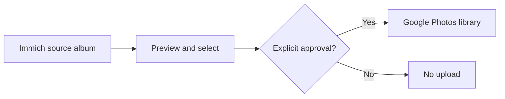

<p align="center"></p>
<p align="center"></p>

# Immich → Google Photos Sync

<p align="center">🇬🇧 <strong>English</strong> · <a href="README.pl.md">🇵🇱 Polski</a></p>

<p align="center"><strong>Your photos. Your selection. Your approval.</strong><br>Self-hosted, manually approved transfers from Immich to Google Photos.</p>

<p align="center"><a href="https://github.com/sp7uto/immich-google-photos-sync/releases"></a>  </p>

**[Installation](docs/INSTALLATION.md) · [OAuth](docs/GOOGLE-OAUTH.md) · [Security](SECURITY.md) · [Wiki EN](docs/wiki/Home.md) · [Wiki PL](docs/wiki/Home-PL.md)**

> Nothing leaves Immich until you select the files and explicitly approve their upload.

## Overview

Immich → Google Photos Sync is a Docker service, designed with Synology NAS in mind. It reads photos from an Immich source album (default: `do publikacji`), lets you preview and check individual assets in a local web panel, and sends only the approved selection to the **Google Photos library**. Immich originals remain untouched. This is **one-way, manual-first transfer**, not continuous or bidirectional synchronization.



## Features

| Feature | Behavior |
| --- | --- |
| Selection | Photo thumbnails, filenames, checkboxes and sent status |
| Queue | Progress, pause, resume and cancel between files |
| History | Local SQLite tracking; CSV history and SQLite backup |
| Uncertain transfers | `uploading` / `needs_review` are blocked pending human review |
| Manual review | Explicitly mark verified Google uploads or unlock safe retries; decision CSV |
| Deployment | Docker Compose; optional non-root override; Synology workflow |
| Privacy | Loopback-only default; optional `PANEL_PASSWORD`; no public OAuth callback |

<p align="center"></p>

## Quick start

**Requirements:** Docker Compose, a reachable Immich API, an Immich API key with permission to access and download the source images, and Google OAuth desktop credentials.

```bash
git clone https://github.com/sp7uto/immich-google-photos-sync.git
cd immich-google-photos-sync
cp .env.example .env
mkdir -p data
# Edit .env; generate credentials.json and token.json using docs/GOOGLE-OAUTH.md.
docker compose up -d --build
```

The default panel binds to **127.0.0.1:8787** on the Docker host. For remote use, employ a trusted VPN, SSH tunnel or authenticated HTTPS proxy. **Do not publish port 8787 directly on the internet.**

## Everyday workflow

1. Create an Immich album named `do publikacji` (or use the configured `SOURCE_ALBUM`).
2. Add photos, then open the local panel.
3. Inspect thumbnails and select items with checkboxes.
4. Confirm **Send selected**, then monitor the queue.
5. Check sent items, export history or back up SQLite if needed.

If a transfer is interrupted or uncertain, check Google Photos before deciding whether to mark an item as sent or unblock a retry. Do not blindly clear the database.

## Important limitations

- Uploads land in the **Google Photos library**, with **no automatic destination album assignment**.
- An OAuth token is generated separately; there is no built-in Google sign-in screen.
- The web panel has no built-in HTTPS. HTTP Basic authentication is optional.
- Video transfer is off by default; RAW media needs testing.
- Images are **not removed from Immich**. SQLite is local; there is no two-way sync.
- No formal security audit has been conducted.

## Documentation / Wiki

| English | Polski |
| --- | --- |
| [README](README.md) | [README](README.pl.md) |
| [Installation](docs/INSTALLATION.md) | [Instalacja](docs/INSTALLATION.pl.md) |
| [Google OAuth](docs/GOOGLE-OAUTH.md) | [Google OAuth](docs/GOOGLE-OAUTH.pl.md) |
| [Security](SECURITY.md) | [Bezpieczeństwo](SECURITY.pl.md) |
| [Synology operations](docs/SYNOLOGY.en.md) | [Synology — instrukcja](docs/SYNOLOGY-PL.md) |
| [Wiki Home](docs/wiki/Home.md) | [Wiki Home-PL](docs/wiki/Home-PL.md) |

GitHub Wiki page sources are maintained in [`docs/wiki/`](docs/wiki/). These files are available in the main repository; publication to the separate GitHub Wiki repository is a separate step.

**Release:** v3.1.6 refines the app icon; upload behavior was confirmed on Synology for v3.1.3. Publishing a GitHub release does not, by itself, deploy the Synology container. Follow the deployment instructions for your installation.

This independent project is not affiliated with Immich or Google.

<p align="center"></p>
