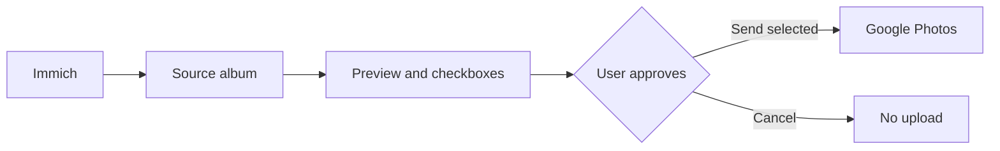

<div align="center">

# 📷 Immich → Google Photos Sync


### Your photos. Your selection. Your approval.

**Self-hosted, manual-first photo transfer from Immich to Google Photos.**

  

**[English](README.md) · [Polski](docs/README.pl.md) · [Installation](docs/INSTALLATION.md) · [OAuth](docs/GOOGLE-OAUTH.md) · [Security](SECURITY.md)**

</div>

> **Nothing leaves your Immich library unless you explicitly select it and press Send.**

## How it works



This independent Docker service reads assets from a designated Immich album (default: `do publikacji`), previews thumbnails in a local web panel, and uploads **only checked assets** after confirmation. Local SQLite state tracks successful uploads.

## Highlights

- **Manual-first** selection and explicit approval.
- **Preview before upload** with thumbnails, filenames and sent status.
- **Queue controls:** progress, pause, resume and cancel between files.
- **Local history:** CSV export and SQLite state backup.
- **Docker-friendly:** developed for Synology NAS.
- **Private by design:** no public callback URL required for OAuth.

## Quick start

```bash
cp .env.example .env
mkdir -p data
# Edit .env and generate Google OAuth credentials/token as documented.
docker compose up -d --build
```

The default Compose file binds the panel to **127.0.0.1 only**. Open `http://localhost:8787` on the Docker host, or use an authenticated SSH tunnel / trusted VPN. For access from another machine, configure a secured reverse proxy or explicitly change the bind address; never publish the unauthenticated panel to the internet.

## Workflow

1. Create an Immich album named `do publikacji`.
2. Add photos you intend to export.
3. Review the photos from the Immich album in the panel. Google Photos uploads go to the **library**, not automatically to a specific album.
4. Check the files and press **Send selected**.
5. Follow progress and export history if needed.

## Current limitations

- Google Photos uploads go to the library; **no automatic Google Photos album assignment**. The existing album-creation API is not part of the upload workflow.
- OAuth token must be generated separately; no OAuth login screen.
- Optional HTTP Basic authentication via `PANEL_PASSWORD` (protects panel and API). No built-in HTTPS; never expose port 8787 publicly.
- Asset search paginates beyond 1,000 items; verify behavior against your Immich version.
- SQLite state is local; this is not bidirectional sync.
- Videos are disabled by default; RAW formats need testing.
- Files are **not deleted from Immich**.
- No formal security audit has been performed.

## Documentation

- [Installation](docs/INSTALLATION.md)
- [Google OAuth](docs/GOOGLE-OAUTH.md)
- [Polska dokumentacja](docs/README.pl.md)
- [Security](SECURITY.md)
- [Changelog](CHANGELOG.md)
- [Synology deployment, incident handling and release workflow (PL)](docs/SYNOLOGY-PL.md)

**Release status:** The versionless branded icon is used as favicon and in the panel heading. v3.1.6 improves its clean vector rendering; upload behavior is unchanged from v3.1.3, whose library upload was confirmed on a private Synology installation on 2026-11-03. Deployment to Synology is **manual**, via `deploy/update-synology.sh vX.Y.Z`; publishing on GitHub does not update the running container automatically. Not affiliated with Immich or Google.
