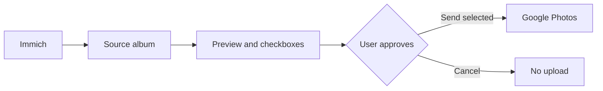

<div align="center">

# 📷 Immich → Google Photos Sync

### Your photos. Your selection. Your approval.

**Self-hosted, manual-first photo transfer from Immich to Google Photos.**

  

**[English](README.md) · [Polski](docs/README.pl.md) · [Installation](docs/INSTALLATION.md) · [OAuth](docs/GOOGLE-OAUTH.md) · [Security](SECURITY.md)**

</div>

> **Nothing leaves your Immich library unless you explicitly select it and press Send.**

## How it works



This independent Docker service reads assets from a designated Immich album (default: `Do Google Photos`), previews thumbnails in a local web panel, and uploads **only checked assets** after confirmation. Local SQLite state tracks successful uploads.

## Highlights

- **Manual-first** selection and explicit approval.
- **Preview before upload** with thumbnails, filenames and sent status.
- **Queue controls:** progress, pause, resume and cancel between files.
- **Local history:** CSV export and SQLite state backup.
- **Docker-friendly:** developed for Synology NAS.
- **Private by design:** no public callback URL required for OAuth.

## Quick start

```bash
cp .env.example .env
mkdir -p data
# Edit .env and generate Google OAuth credentials/token as documented.
docker compose up -d --build
```

Open `http://YOUR-NAS-IP:8787` **only on a trusted LAN or via VPN**.

## Workflow

1. Create an Immich album named `Do Google Photos`.
2. Add photos you intend to export.
3. Review thumbnails in the local web panel.
4. Check the files and press **Send selected**.
5. Follow progress and export history if needed.

## Limitations of v3.0

- Uploads go to the Google Photos library, **not a named Google album**.
- OAuth token must be generated separately; no OAuth login screen.
- **No built-in panel authentication or HTTPS. Never expose port 8787 publicly.**
- Asset search uses a single page (up to 1,000 items).
- SQLite state is local; this is not bidirectional sync.
- Videos are disabled by default; RAW formats need testing.
- Files are **not deleted from Immich**.
- No formal security audit has been performed.

## Documentation

- [Installation](docs/INSTALLATION.md)
- [Google OAuth](docs/GOOGLE-OAUTH.md)
- [Polska dokumentacja](docs/README.pl.md)
- [Security](SECURITY.md)
- [Changelog](CHANGELOG.md)

**v3.0 — field-tested in a private Synology deployment.** Not affiliated with Immich or Google.
