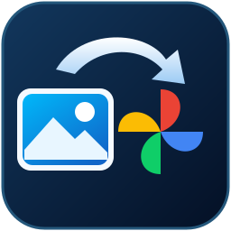
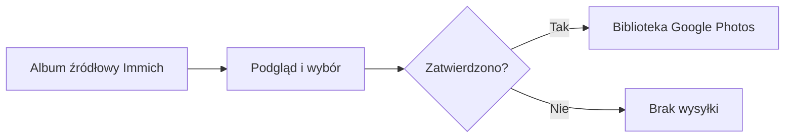

<p align="center"></p>
<p align="center"></p>

# Immich → Google Photos Sync

<p align="center">🇵🇱 <strong>Polski</strong> · <a href="README.md">🇬🇧 English</a></p>

<p align="center"><strong>Twoje zdjęcia. Twój wybór. Twoja decyzja.</strong><br>Samodzielnie hostowany transfer fotografii z Immich do Google Photos, wyłącznie po zatwierdzeniu.</p>

<p align="center"><a href="https://github.com/sp7uto/immich-google-photos-sync/releases"></a>  </p>

**[Instalacja](docs/INSTALLATION.pl.md) · [OAuth](docs/GOOGLE-OAUTH.pl.md) · [Bezpieczeństwo](SECURITY.pl.md) · [Wiki PL](docs/wiki/Home-PL.md) · [Wiki EN](docs/wiki/Home.md)**

> Żadne zdjęcie nie opuści biblioteki Immich bez Twojego wyboru i wyraźnego zatwierdzenia wysyłki.

## O projekcie

Immich → Google Photos Sync jest niezależną usługą Docker, przygotowaną z myślą między innymi o Synology NAS. Odczytuje zdjęcia ze wskazanego albumu Immich (domyślnie `do publikacji`), wyświetla podgląd w lokalnym panelu WWW i wysyła **wyłącznie zaznaczone oraz zatwierdzone** pliki do **biblioteki Google Photos**. Oryginały pozostają w Immich. To **jednokierunkowy transfer z ręcznym zatwierdzaniem**, a nie ciągła czy dwukierunkowa synchronizacja.



## Możliwości

| Funkcja | Działanie |
| --- | --- |
| Wybór plików | Miniatury, nazwy, pola wyboru i stan wysyłki |
| Kolejka | Postęp, pauza, wznowienie i anulowanie pomiędzy plikami |
| Historia | Lokalna baza SQLite, eksport CSV oraz kopia bazy |
| Niepewny wynik | `uploading` / `needs_review` wymagają świadomej weryfikacji |
| Rozstrzyganie | Potwierdzenie pliku znalezionego w Google lub odblokowanie bezpiecznej ponownej próby; historia decyzji CSV |
| Uruchomienie | Docker Compose, opcjonalny wariant bez roota, wdrażanie na Synology |
| Prywatność | Dostęp lokalny domyślnie, opcjonalne `PANEL_PASSWORD`, bez publicznego adresu zwrotnego OAuth |

<p align="center"></p>

## Szybki start

**Wymagania:** Docker Compose, dostęp do API Immich i klucz umożliwiający odczyt oraz pobieranie zdjęć, a także dane klienta OAuth Google typu Desktop.

```bash
git clone https://github.com/sp7uto/immich-google-photos-sync.git
cd immich-google-photos-sync
cp .env.example .env
mkdir -p data
# Uzupełnij .env i wygeneruj credentials.json oraz token.json zgodnie z docs/GOOGLE-OAUTH.pl.md.
docker compose up -d --build
```

Domyślnie panel nasłuchuje tylko na **127.0.0.1:8787** hosta Docker. Zdalny dostęp realizuj przez zaufaną sieć VPN, tunel SSH lub zabezpieczony serwer proxy HTTPS. **Nie wystawiaj portu 8787 bezpośrednio do internetu.**

## Codzienna praca

1. Utwórz album Immich `do publikacji` albo wskaż inny poprzez `SOURCE_ALBUM`.
2. Dodaj fotografie i otwórz panel WWW.
3. Obejrzyj miniatury i zaznacz wybrane pliki.
4. Potwierdź **Wyślij zaznaczone** i obserwuj postęp.
5. Sprawdź historię wysyłek, pobierz CSV lub wykonaj kopię SQLite.

Przy przerwanym lub niepewnym transferze sprawdź bibliotekę Google Photos przed oznaczeniem pliku jako wysłanego albo odblokowaniem ponownej próby. Nie usuwaj wpisów bazy w ciemno.

## Ważne ograniczenia

- Fotografie trafiają do **biblioteki Google Photos**; brak automatycznego przypisania do albumu.
- Token OAuth powstaje w osobnym kroku; aplikacja nie ma ekranu logowania Google.
- Panel nie ma wbudowanego HTTPS. Hasło HTTP Basic jest opcjonalne.
- Wideo jest domyślnie wyłączone; pliki RAW wymagają testów.
- Program **nie usuwa oryginałów z Immich** i nie synchronizuje bibliotek w obie strony.
- Nie przeprowadzono formalnego audytu bezpieczeństwa.

## Dokumentacja / Wiki

| Polski | English |
| --- | --- |
| [README](README.pl.md) | [README](README.md) |
| [Instalacja](docs/INSTALLATION.pl.md) | [Installation](docs/INSTALLATION.md) |
| [Google OAuth](docs/GOOGLE-OAUTH.pl.md) | [Google OAuth](docs/GOOGLE-OAUTH.md) |
| [Bezpieczeństwo](SECURITY.pl.md) | [Security](SECURITY.md) |
| [Synology — instrukcja](docs/SYNOLOGY-PL.md) | [Synology operations](docs/SYNOLOGY.en.md) |
| [Wiki Home-PL](docs/wiki/Home-PL.md) | [Wiki Home](docs/wiki/Home.md) |

Źródła stron Wiki znajdują się w [`docs/wiki/`](docs/wiki/). Są dostępne w głównym repozytorium; publikacja w osobnym repozytorium GitHub Wiki wymaga oddzielnego kroku.

**Wydanie:** v3.1.6 udoskonala ikonę; poprawność wysyłania potwierdzono na Synology w v3.1.3. Publikacja wydania w GitHub nie aktualizuje samoczynnie kontenera NAS — stosuj procedurę wdrożeniową.

Projekt niezależny, niepowiązany oficjalnie z Immich ani Google.

<p align="center"></p>
