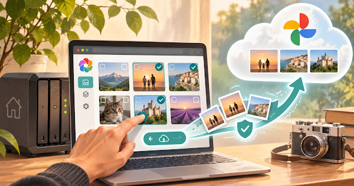
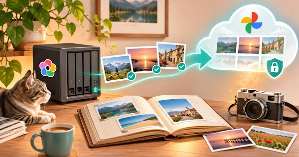

# Immich → Google Photos Sync — Wiki

**[🇵🇱 Polski](https://github.com/sp7uto/immich-google-photos-sync/wiki/Home-PL) · [🇬🇧 English](https://github.com/sp7uto/immich-google-photos-sync/wiki/Home)**

**Twoje zdjęcia. Twój wybór. Twoja decyzja.**

Niezależna usługa Docker służąca do **ręcznego, jednokierunkowego** transferu wybranych zdjęć z Immich do **biblioteki Google Photos**. Oryginały pozostają w Immich. Każdą wysyłkę trzeba świadomie zatwierdzić.

## Dokumentacja

- [Opis projektu / README](https://github.com/sp7uto/immich-google-photos-sync/blob/main/README.pl.md)
- [Instalacja](https://github.com/sp7uto/immich-google-photos-sync/blob/main/docs/INSTALLATION.pl.md)
- [Google OAuth](https://github.com/sp7uto/immich-google-photos-sync/blob/main/docs/GOOGLE-OAUTH.pl.md)
- [Bezpieczeństwo](https://github.com/sp7uto/immich-google-photos-sync/blob/main/SECURITY.pl.md)
- [Synology — eksploatacja](https://github.com/sp7uto/immich-google-photos-sync/blob/main/docs/SYNOLOGY-PL.md)
- [Historia zmian](https://github.com/sp7uto/immich-google-photos-sync/blob/main/CHANGELOG.md)
- [English Wiki](https://github.com/sp7uto/immich-google-photos-sync/wiki/Home)

## Jak działa

1. Dodaj zdjęcia do albumu Immich `do publikacji`.
2. Obejrzyj je w lokalnym panelu WWW (domyślnie localhost:8787).
3. Zaznacz zdjęcia i zatwierdź wysyłkę.
4. Obserwuj postęp i historię SQLite/CSV.
5. Niepewne transfery sprawdzaj w Google Photos przed ponowieniem.

## Ważne

Program nie przypisuje zdjęć automatycznie do albumów Google, nie usuwa oryginałów i nie synchronizuje w obie strony. Panel nie ma własnego TLS — stosuj zaufaną sieć, VPN lub zabezpieczone proxy. Tokeny OAuth przechowuj prywatnie. Nie wykonano formalnego audytu bezpieczeństwa.

Pełny szybki start i spis dokumentacji zawiera [README](https://github.com/sp7uto/immich-google-photos-sync/blob/main/README.pl.md).

