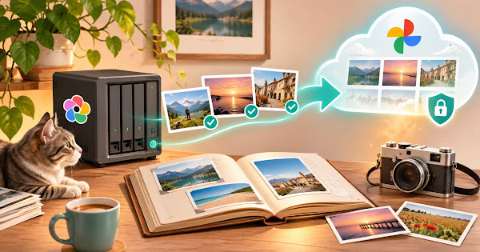

# Immich → Google Photos Sync — Wiki

**[🇬🇧 English](https://github.com/sp7uto/immich-google-photos-sync/wiki/Home) · [🇵🇱 Polski](https://github.com/sp7uto/immich-google-photos-sync/wiki/Home-PL)**

**Your photos. Your selection. Your approval.**

A self-hosted Docker service for **manual, one-way** transfer of selected Immich photos to the **Google Photos library**. Originals stay on Immich. An operator explicitly chooses and approves each batch.

## Guides

- [Project overview / README](https://github.com/sp7uto/immich-google-photos-sync/blob/main/README.md)
- [Installation](https://github.com/sp7uto/immich-google-photos-sync/blob/main/docs/INSTALLATION.md)
- [Google OAuth](https://github.com/sp7uto/immich-google-photos-sync/blob/main/docs/GOOGLE-OAUTH.md)
- [Security](https://github.com/sp7uto/immich-google-photos-sync/blob/main/SECURITY.md)
- [Synology operations](https://github.com/sp7uto/immich-google-photos-sync/blob/main/docs/SYNOLOGY.en.md)
- [Change history](https://github.com/sp7uto/immich-google-photos-sync/blob/main/CHANGELOG.md)
- [Polish Wiki / Wiki po polsku](https://github.com/sp7uto/immich-google-photos-sync/wiki/Home-PL)

## Workflow

1. Add intended images to Immich album `do publikacji`.
2. Review the local web panel (default localhost:8787).
3. Select photos and explicitly approve sending.
4. Monitor progress and examine SQLite/CSV history.
5. Review uncertain uploads against Google Photos before a retry.

## Important notes

The program does not assign destination albums, delete originals, or sync in both directions. The web panel has no built-in TLS; restrict it to trusted networks, VPN or a secure proxy. Keep OAuth credentials private. No formal security audit has been conducted.

See the main [README](https://github.com/sp7uto/immich-google-photos-sync/blob/main/README.md) for the exact quick start and all documentation links.

