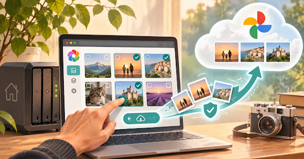

# ✅ Wybór i wysyłanie zdjęć

[🇵🇱 Polski](✅-Wybór-zdjęć) · [🇬🇧 English](✅-Workflow)

1. Utwórz album Immich `do publikacji` albo zmień `SOURCE_ALBUM`.
2. Dodaj do niego fotografie przeznaczone do rozważenia.
3. W panelu dostępnym z zaufanej sieci obejrzyj miniatury i nazwy plików.
4. Zaznacz wybrane zdjęcia i zatwierdź **Wyślij zaznaczone**.
5. Obserwuj kolejkę; możesz ją wstrzymać, wznowić lub anulować pomiędzy plikami.
6. Eksportuj historię CSV lub wykonaj kopię SQLite.

Zdjęcia trafiają do **biblioteki Google Photos**, nie automatycznie do konkretnego albumu. Oryginały zostają w Immich.

Statusy `uploading` i `needs_review` wymagają niezależnego sprawdzenia biblioteki Google przed ręcznym rozstrzygnięciem. Nie ponawiaj w ciemno.

[Instrukcja instalacji](https://github.com/sp7uto/immich-google-photos-sync/blob/main/docs/INSTALLATION.pl.md)
